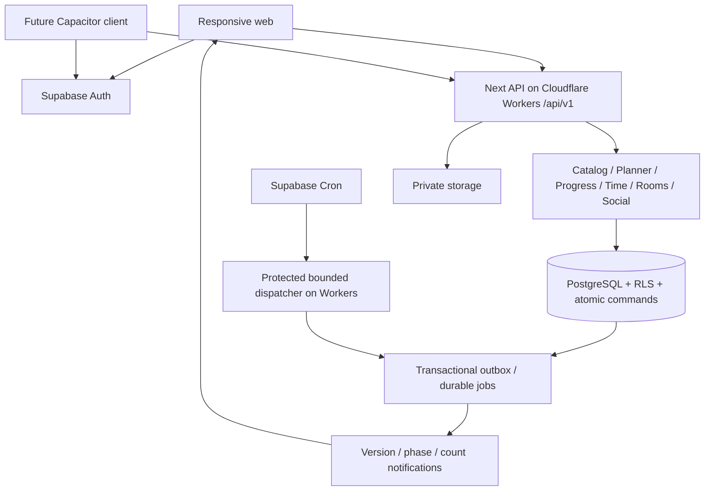

# دِيمة — المعمارية والبيانات والتشغيل

> تحديث B2: المكتبة والكورس الخاص والخطة وToday والإنجاز تحققت محليًا بعد تحسين الدارك؛ [الأدلة الحالية](evidence/B2.md) و[حالة المراحل](STATUS_AR.md) تتقدمان على حالة التنفيذ التاريخية أدناه. لا إطلاق عام أو APK.

الإصدار: 1.2 مع تحديث B0 — 2026-10-31. أُنجز أساس محلي وmigration تجريبية وفق [دليل B0](evidence/B0.md). نموذج المنتج أدناه عقد تنفيذ للمراحل اللاحقة؛ Google OAuth أُعد لاحقًا بتفويض المستخدم؛ لا DNS أو نشر أو Supabase/Workers مستضاف.
المرجع الوظيفي: [PRD](PRD_AR.md). مدد الجولات والسقوف والحضور ومعايير realtime مرجعها الوحيد [ROOMS_AND_FOCUS_SPEC](ROOMS_AND_FOCUS_SPEC_AR.md).
هذه الوثيقة و[قرار الاستضافة المعتمد](HOSTING_DECISION_AR.md) تحلان محل ترشيحات Heroku Student وVercel القديمة. قواعد التخطيط والاحتساب الحالية في [RECOVERY_AND_PROGRESS](RECOVERY_AND_PROGRESS_SPEC_AR.md)؛ المراجع السابقة تاريخ قرار لا مرجعًا متعارضًا للتنفيذ.

تنفيذ B2 الخاص يستخدم تجميعة JSONB ذات revision وإيصالات أوامر مختصرة وتطبيقًا ذريًا؛ هذا يتقدم على تفاصيل التخزين المخططة أدناه في نطاق B2. [العقد المنفّذ](B2_API_AND_LEARNING_AR.md) يشرح الصلاحيات والتزامن والحدود، ولا يدعي تنفيذ مخطط النشر الاجتماعي للمراحل اللاحقة.

## 1. القرار التقني وحدوده

- تطبيق **Next.js + React + TypeScript** واحد، بوحدات وظائف منفصلة داخليًا؛ صفحات عامة وواجهة عضو وإدارة و HTTP API في نفس المستودع.
- **Supabase PostgreSQL + Auth + Realtime**؛ Storage خاص للصور/التصديرات عند الحاجة. البيانات الدائمة لا توضع في ذاكرة Worker أو ملفاته المؤقتة.
- **Cloudflare Workers + Supabase Free** اختيار المستخدم لبداية 50–100 مستخدم؛ Workers للواجهة والـAPI والملفات الثابتة، دون Pages منفصلة. تسجيل dima.study يبقى لدى Spaceship وDNS المخطط Cloudflare. لا ترقية مدفوعة تلقائية أو وعد بمجانية دائمة.
- أثبت B0 محليًا Next 16.4.3 مع OpenNext Cloudflare 1.20.15 وWrangler 4.156.0، وبناء React مستقل عبر Vite. lockfile هو المرجع الدقيق؛ التوافق البعيد وCPU المستضاف باقيان قبل الإطلاق. لا نقل لقاعدة المنصة إلى D1 ولا للغرف إلى Durable Objects؛ استثناء تقني معتمد غير منفذ: D1 مستقلة لسجل الخصوصية المشفّر فقط وفق [ملحق السجل والاستعادة](PRIVACY_LEDGER_CONTRACT_AR.md)، دون sockets إضافية. ليست كل مكتبة Node مدعومة تلقائيًا.
- الويب المتجاوب أولًا، وAndroid عبر Capacitor لاحقًا على نفس API والحسابات والبيانات؛ لا API حصري خلف Server Actions. حزم العميل/المكونات قابلة للمشاركة وغلاف موبايل قابل للبناء مستقل عن SSR عند الحاجة؛ لا يُغلف خادم Next في APK. مسار البناء الفعلي يُثبت في B0/M0. التفاصيل وحدود الخلفية في [قرار Android](ANDROID_DECISION_AR.md).
- لا microservices، ولا AI للتخطيط، ولا Redis أو خادم WebSocket خاص في v1. محرك التخطيط دالة حتمية قابلة للاختبار.
- GitHub مستودع خاص و CI؛ GitHub Pages ليس باك إند الحسابات والوقت والرومز. الموقع الكامل ليس static export؛ حزمة عميل Android لها build منفصل قابل للتغليف، والخدمات تبقى على Workers/Supabase.
- ديمة مشروع ومستودع وخدمات مستقلة عن كنف؛ لا استعمال لتفويض كنف أو بياناته أو أسراره.

Next يدعم التشغيل الذاتي، و Supabase يوفّر RLS ودوال قاعدة البيانات؛ الاختيار يحتاج تحقق نشر فعلي وإصدارات مثبتة بالـ lockfile، لا تعويم الاعتماد على latest. [Next self-hosting](https://nextjs.org/docs/app/guides/self-hosting)، [RLS](https://supabase.com/docs/guides/database/postgres/row-level-security).

## 2. حدود الوحدات وملكية الحالة

| الوحدة | مسؤوليتها |
|---|---|
| `accounts` | الدخول، حالة الحساب، الأدوار، المنطقة الزمنية، الخصوصية |
| `catalog` | منهج خاص/منشور، versions، offering، نطاقات الانضمام، مراجعة النشر |
| `planning` | سعة موحدة، تقديرات، preview حتمي، تطبيق الخطة والاستدراك |
| `progress` | الإنجاز والعمل الجزئي، baseline، أصل الاحتساب والتصحيح |
| `time` | سجل الوقت الوحيد للفردي والرومز، التحكم عبر الأجهزة والأهلية |
| `rooms` | metadata، عضوية، Run/round، المضيف، الحضور والإزالة |
| `social` | طلبات المتابعة، مشاركة حقول محددة، الحظر، إسقاطات العرض |
| `ranking` | نطاقات وأوزان ثابتة، إسقاطات قابلة لإعادة البناء |
| `operations` | Jobs/outbox، moderation، audit، export/delete/restore |

العميل يملك اختيار العرض ومسوداته فقط. لا يقرر نهائية الإنجاز أو صلاحية الاشتراك أو رصيد الوقت. `Saved` بعد commit؛ `Pending sync` عند الحفظ المحلي. الرسوم لا تعدّل سجلات المجال.
التنسيق يستخدم توكنز ديمة ومكونات React المراجعة؛ تبقى مكونات 21st خاضعة لترخيص الأصل. لا يلزم أي اشتراك إضافي لتشغيل الأصول بعد تحقق حقوق استخدامها.

## 3. نموذج البيانات

كل السجلات لها UUID و`created_at`؛ السجلات القابلة للتعديل لها `revision bigint`. الأوقات `timestamptz`، والأيام التخطيطية `date` مع IANA timezone؛ المدد ثوانٍ صحيحة، وأوزان الترتيب أعداد دقيقة دون float.

| السجلات | الحقول والعلاقة الحاسمة |
|---|---|
| `Account / Profile / RoleGrant` | `auth_user_id`، status، timezone، display_name؛ الأدوار لا تُؤخذ من metadata يحررها العضو |
| `PrivacyPolicy / ShareGrant` | defaults خاصة؛ metric، audience، selected_offering_id، revision؛ تظهر الإعدادات للمستخدم |
| `Course / Offering / CurriculumVersion` | مالك خاص أو عرض عام مراجع؛ إصدار منشور غير قابل للتعديل |
| `Module / Task / Resource` | ترتيب، نوع، Required/Optional/Supporting/Alternative، source_url، estimate provenance |
| `TaskLineage / VersionMapping` | هوية تعلم ثابتة؛ ربط نسخ معتمد لا يُستنتج من تطابق الاسم |
| `Enrollment / EnrollmentTask` | user، offering/version، نطاق مختار، active؛ يمنع تغطية نفس lineage مرتين في انضمامات نشطة |
| `TaskState / ProgressEvent / WorkEvent` | حالة حالية + Complete/Undo/Baseline/Imported؛ reported_at منفصل عن accepted_at؛ WorkEvent يحمل effort/date/source و origin_completion_event_id فريدًا إذا تولد من إكمال |
| `FirstCreditClaim` | user + lineage، أول accepted_at ونافذته، original_event_id، active؛ لا يعاد إنشاء الأصل بعد Undo |
| `Availability / CapacityException / Goal` | سعة مجمعة لكل الكورسات، راحة/استثناء، target_date، priorities، revision |
| `PlanVersion / ScheduledBlock` | نسخة معتمدة، task، date، effort، pinned؛ الماضي التاريخي منفصل عن توزيع المستقبل |
| `PlanPreview` | input revisions/hash بما فيها Goal/Priority، planner/policy version، اقتراح قبل/بعد، reasons، forecast، unallocated، expires_at |
| `TimeSession / TimeInterval / TimeCorrection` | user، mode Work/Learning، source Solo/Room/Open، state، cap، provenance، eligibility |
| `SessionControl` | session، device_id، control_version؛ الجهاز وسيلة تحكم وليس هوية المستخدم |
| `Room / RoomMembership` | public metadata، optional public offering، owner/status، current_host_membership_id حتى في Lobby؛ acknowledged_visibility، generation، joined/left/removed/expired و seat_expires_at |
| `RoomRun / RoundParticipation` | preset snapshot ثابت، timestamps، host/version؛ user/run/round → TimeSession |
| `PresenceLease` | membership_id + presence_generation، server_last_seen، expires_at؛ مستقل عن وجود Run ليعمل في Lobby؛ للتحكم/العرض فقط، لا لإثبات التعلم |
| `FollowRelationship / UserBlock` | follower/subject، Requested/Accepted/Declined/Revoked؛ block ثنائي الأثر على العرض |
| `SharedMilestone / Encouragement` | نشر صريح لمعلم في كورس عام إلى المقبولين؛ source_event/offering/owner/visibility_revision؛ تشجيع واحد لكل actor/milestone مع حد السياسة؛ لا نقاط |
| `PublicationRequest / ReviewDecision` | snapshot ثابت، reviewer، reason/status؛ المنهج فقط دون خطة أو تقدم |
| `ComparisonScope / CreditPolicy / RankingProjection` | version ونطاق وأوزان معلنة، window، watermark، generation، corrected_at |
| `Report / ModerationAction / AuditEvent` | target، restricted reporter، reason، actor، affected_at؛ لا أسرار في payload |
| `IdempotencyRecord / OutboxEvent / Job` | account+operation، payload_hash، result؛ dedupe، attempts، lease، next_run_at |
| `ExportRequest / DeletionRequest / PrivacyTombstone` | requester/state، أثر الحذف/السحب، retention deadline، artifact expiry |

`TimeSession` هو اسم السجل المركزي؛ لا تُنشأ جداول وقت منفصلة لكل صفحة أو روم. جدول `TimeInterval` يحمل الفترات المغلقة والمفتوحة، و`TimeCorrection` يُبقي أصل التصحيح قابلًا للتفسير.
`ShareGrant.audience` في v1 = `AcceptedFollowers` أو `CoursePeers`؛ `metric` = `WeeklyTime` أو `WeeklyRhythm` أو `PublicCourseProgress` أو `PublishedCourseMilestone`. الأخير يتطلب SharedMilestone منشورًا صراحة بالإضافة إلى المنحة، وليس حقًا في جميع أحداث الماضي والمستقبل. CoursePeers يرى تقدم/مرحلة الكورس المختار فقط؛ WeeklyTime/WeeklyRhythm/Milestone للمقبولين. وجود متابعة مقبولة وحده لا يمنح الحقول.

## 4. قيود قاعدة البيانات والفهارس

1. FK للملكية والعلاقات؛ `CHECK end_at >= start_at` ووزن/جهد/مدة غير سالبة، وصفر المقام يمنع ترتيب التقدم.
2. partial unique على `TimeSession(user_id)` للحالات Running/Paused/NeedsReview؛ يمنع ازدواج الفردي والروم والعمل والتعلم معًا.
3. unique فترة مفتوحة لكل Session؛ منع تداخل الفترات المعتمدة للحساب بقيد range/exclusion أو معاملة قفل حساب موثقة ومختبرة. خيار التنفيذ المعتمد: range `[start,end)` و GiST exclusion؛ التصحيحات غير المعتمدة تبقى منفصلة.
4. unique `(user_id, task_lineage_id)` في FirstCreditClaim؛ uniqueness للنطاق النشط في EnrollmentTask؛ mapping لترقية المنهج لا ينشئ أول احتساب جديدًا.
5. unique `(user_id, operation_id)`؛ payload hash مختلف لنفس العملية = رفض. unique `(user_id, run_id, round_index)` يمنع تكرار المشاركة.
6. partial unique للـ Run النشط لكل Room؛ انضمام آخر مقعد والمطالبة بالمضيف يُحسمان تحت قفل Room/Run لا من عدد يرسله العميل.
7. unique `(follower_id, subject_id)` مع منع self-follow؛ unique block pair واتجاهه؛ إعادة الطلب المحدود لا تكرر notifications.
8. فهارس `(owner_id, updated_at, id)`، `(user_id, local_date)`، `(user_id, accepted_at)`، `(room_id,status)`، `(subject_id,status)`؛ pagination بمؤشر ثابت لا OFFSET للقوائم الطويلة.
9. فهارس Jobs على `(status,next_run_at)` و lease expiry؛ ranking على `(scope_id,window_start,generation,score,user_id)`؛ الفهارس تنفذ بعد قياس query plans.
10. تمنع صلاحيات DB تعديل CurriculumVersion المنشور و FirstCreditClaim الأصل مباشرة؛ كل تغيير يتم بأمر مجال أو migration مدقق.

ترتيب القفل العام: Account للعمليات الشخصية، ثم جميع Room IDs المطلوبة بترتيب UUID تصاعدي ثابت، ثم جميع Run IDs بالترتيب نفسه، ثم الكيان؛ يشمل النقل الذري بين رومين. retries محدودة ل deadlock/serialization بنفس operationId قبل إظهار Conflict. حذف/إيقاف روم يثبت suspended_at بمعاملة قصيرة دون قفل حسابات الأعضاء، ثم يسوّي كل حساب بمعاملة مستقلة Account-first؛ كل قراءة/أمر يحترم cutoff فورًا. لا نمسك Room ثم ننتظر Accounts مختلفة.

## 5. المعاملات الحساسة

- **Start/JoinRound:** تحقق هوية وحالة وعضوية وحدود؛ lock الحساب؛ تسوية الحد السابق عند الحاجة؛ insert Session/Interval/Participation + idempotency result + outbox في commit واحد. وجود NeedsReview يُرجع رابط المراجعة، ولا يتجاوزه البدء.
- **Pause/Resume/Finish:** تحقق `control_version` و`expectedRevision`؛ اقطع الفترة عند الحد المقبول من الخادم وحدّ الجولة/السقف؛ لا احتساب لاستراحة. وقت الحد لا يتغير لتأخر Cron.
- **Complete/Undo:** تحديث TaskState وأحداثه و FirstCreditClaim ومراجعة progress في معاملة؛ الإكمال الحالي يُنشئ WorkEvent لجهد المتبقي المقبول فقط وفق عقد Recovery، دون تكرار WorkedOn سابق. Unknown effort يعطل ملء باقي اليوم تلقائيًا حتى تأكيده. Undo mistake يبطل أثر الجهد المولّد من هذا الإكمال وحده، لا أعمالًا مستقلة. Undo يعطل claim الحالي، و Complete لاحق يعيد الأصل بنافذته القديمة، لا مكافأة جديدة.
- **ApplyPreview:** lock الحساب/الخطة؛ تحقق revisions للنطاق والتقدير والتقدم والسعة والخطة والهدف/الأولوية ونسخة قواعد المحرّك + expiry؛ طبّق المستقبل ونسخة جديدة فقط. mismatch = `PREVIEW_STALE` دون أي تعديل جزئي.
- **Publish/Upgrade:** نشر snapshot مع lineage mapping، ثم انتقال العضو بعد معاينة؛ لا تغيير نطاقه أو نسبة إنجازه في الخفاء.
- **Sharing/Block:** commit السياسة + visibility revision + invalidation؛ كل قراءة جديدة تفحص السياسة الحالية حتى لو projection أو cache قديمة.
- **Remove/Suspend:** صلاحية actor + حد فعلي من server time + سجل moderation؛ الوقت السابق الصالح محفوظ، والوصول الخاص يُمنع فورًا.

الأحداث والمخرجات محفوظة في نفس المعاملة؛ الإرسال إلى realtime أو البريد يحدث بعد commit عبر outbox. لا side effect خارجي قبل نجاح البيانات.

## 6. عقود HTTP تحت `/api/v1`

طلب التعديل: `operationId`, `expectedRevision`, `payload`؛ أوامر التحكم تضيف `controlVersion`. لا يقبل `userId` كدليل ملكية. النتيجة: `data`, `revision`, `serverTime`, `operationId`, `requestId`.
عقود TypeScript والتحقق من المدخلات مشتركة، مع JSON/OpenAPI schema قابلة للاختبار؛ الأوامر ليست تحديثًا حرًا لكل حقول DB.

| API | الغرض |
|---|---|
| `GET /me`, `/today`, `/courses`, `/courses/:id`, `/plan` | قراءات المالك؛ cursor/filters محدودة، دون cache عام |
| `GET /library`, `/offerings/:id`, `/rooms` | إسقاطات metadata عامة معتمدة فقط |
| `POST /courses`, `/enrollments`, `/publication-requests` | إنشاء خاص/انضمام/طلب نشر؛ أوامر transition منفصلة |
| `POST /plan/previews`, `/plan/previews/:id/apply` | حساب معاينة ثم تطبيق ذري |
| `POST /tasks/:id/complete`, `/undo`, `/worked-on` | حالة المهمة منفصلة عن الوقت |
| `POST /sessions/start`, `/:id/pause`, `/resume`, `/finish`, `/claim-control`, `/corrections` | سجل الوقت المركزي؛ current session ضمن رد التعارض |
| `POST /rooms/:id/join`, `/leave`, `/runs`, `/rounds/:index/join` | دورة الروم وفق عقد التركيز؛ العضوية لا تنشئ Enrollment |
| `POST /rooms/:id/presence/renew`, `/rooms/:id/switch`; `POST /focus/switch-mode` | تجديد lease الحالية و generation؛ نقل روم أو Finish/Leave/Start ذري بحسب العقد؛ لا جلستان متداخلتان |
| `POST /rooms/:id/host-transfer`, `/host-claim`, `/remove`, `/close` | الدور/الحدود/المراجعات من الخادم |
| `GET /rooms/:id/snapshot`, `/runs/:id/state` | snapshot مصرح لهذا المشاهد؛ لا roster جماعي عام |
| `POST /follow-requests`, `/:id/accept`, `/:id/decline`, `/relationships/:id/revoke` | علاقة اتجاهية مقبولة، لا قبول تلقائي بالمشاركة في روم |
| `POST /sharing`, `/blocks`, `/reports` | حقول محددة واختيار جمهور، حظر وبلاغ |
| `POST /shared-milestones`, `/:id/revoke`, `/:id/encourage` | مشاركة صريحة لكورس عام؛ تحقق المصدر والجمهور والحظر؛ لا اعتماد عدد الجلسات كحقل اجتماعي ضمن v1 |
| `GET /circle`, `/profiles/:id/shared`, `/leaderboards/:scope` | فلترة per-viewer قبل الإرجاع؛ مشاركة عامة مستقلة عن متابعة مقبولة |
| `POST /exports`, `/account/deletion`; `GET /jobs/:id/status` | تحقق إضافي للحذف، وعرض حالة الوظيفة لصاحبها |
| `POST /admin/reviews/:id/decision`, `/admin/moderation` | دور مراجع/مشرف من جدول محمي + audit |

HTTP: `401 AUTH_REQUIRED`، `403 FORBIDDEN`، `404 NOT_FOUND` لإخفاء كيان لا يحق رؤيته، `409 REVISION_CONFLICT / ACTIVE_SESSION / CONTROL_LOST / PREVIEW_STALE / IDEMPOTENCY_MISMATCH / ROOM_FULL`، `410 RESOURCE_CLOSED`، `422 INVALID_INPUT / CAPACITY_CONFLICT`، `429 RATE_LIMITED` مع Retry-After، `503 TEMPORARILY_UNAVAILABLE`.
فقد الرد يُعالج بإعادة نفس operationId أولًا؛ retention لنتائج أوامر الوقت/الإنجاز الحساسة لا يقل عن عمر سجلها، أو تحتفظ tombstone تمنع إعادة التطبيق. لا تتحول عملية قديمة إلى كتابة جديدة لمجرد تنظيف كاش.
إعادة النتيجة لا تتجاوز الصلاحية الحالية: تحقق الحساب والوصول قبل replay، ولا تحفظ roster أو بيانات مشاركين داخل نتيجة أمر قابلة للاسترجاع بعد سحب الوصول.

## 7. الهوية والصلاحيات والخصوصية

- Google OAuth + Email OTP عبر Supabase Auth؛ تحقق هوية الخادم باستخدام SDK الموثق، وتحقق البريد/المزوّد قبل الأفعال الاجتماعية. لا دمج حسابين بنص بريد من العميل.
- SMTP الافتراضي ليس أساس التسجيل العام؛ يلزم SMTP إنتاجي بدومين إرسال موثّق، مثل Resend ضمن الحصة المختارة. [Supabase SMTP](https://supabase.com/docs/guides/auth/auth-smtp).
- RLS على كل جدول مكشوف؛ private owner rows للمالك فقط. قراءات الأعضاء العاديين عبر JWT المستخدم، لا service role شامل لكل الطلبات.
- revoke direct INSERT/UPDATE/DELETE عن سجلات الوقت/الاحتساب/الأدوار؛ أوامر SQL محددة تحقق `auth.uid()` والدور والحالة داخل المعاملة.
- `SECURITY DEFINER` فقط عند الضرورة، `search_path` ثابت/فارغ وأسماء مؤهلة، revoke EXECUTE العام ومنح محدود؛ لا ثقة في owner_id مرسل. [Database functions](https://supabase.com/docs/guides/database/functions).
- أدوار النظام للمهمات الخلفية محصورة؛ المراجع يرى snapshot النشر فقط، والمشرف يرى بيانات البلاغ اللازمة، والمضيف لا يرى سجلات الأعضاء الخاصة.
- المتابعة تبدأ Requested؛ Accepted لا يكشف إلا ShareGrant المختار: weekly time/rhythm ونسب كورسات عامة محددة. اسم الكورس الخاص والملاحظات والجدول وعناوين العمل لا تدخل DTO الاجتماعي أصلًا.
- الظهور في course people، و hour leaderboard، و course leaderboard موافقات منفصلة. الاسم داخل الروم استثناء محدود يظهر شرطه قبل Join؛ لا يغير سياسة الملف العامة.
- الحظر/سحب المتابعة/سحب المشاركة يطبق على API و pagination و notifications والكاش؛ تمنع استجابات مختلفة كشف وجود حساب خاص قدر الإمكان.
- الاستجابات الخاصة `Cache-Control: private, no-store`؛ نتائج عامة مخزنة لا تحتوي raw profiles. rate limits المؤثرة لها عداد مشترك/ذري، لا ذاكرة Worker منفرد فقط.
- عميل Android يحتاج عقد مصادقة وتخزين/تجديد وروابط عودة مستقلًا عن افتراضات cookies المتصفح؛ تحقق الخادم نفسه ملزم، ولا service-role في العميل. M0 يثبت OAuth وPKCE وredirect allowlist والأصول المسموحة وفق قرار Android.
- Cookies/session وفق SDK؛ تغييرات cookie-auth لها Origin/CSRF protection، و TLS، وتنقية نصوص عامة، و CSP؛ الروابط الخارجية http/https فقط ولا server-side fetch عشوائي.
- الأسرار في بيئة السيرفر/secret store، لا Git أو browser bundle أو logs. telemetry يستبعد البريد والنوايا والملاحظات؛ rate limits للتسجيل والإنشاء والمتابعة والإبلاغ وأوامر الوقت.

## 8. Realtime والمزامنة المحلية

- Realtime إشارة invalidation، لا مصدر الرصيد. بث الروم = phase/version/count؛ لا أسماء أو نسب أو roster أو عناوين مهام. بيانات الأعضاء عبر snapshot لكل مشاهد مع سياسة وحظر حاليين.
- انضمام channel خاص يحتاج صلاحية؛ بقاء socket بعد Remove لا يمنح قراءة. لا نعتمد على إلغاء socket وحده لمنع التسريب، لأن payload المشترك خالٍ من البيانات الشخصية.
- الساعة تُشتق محليًا من serverTime وحدود محفوظة، لا ticks خادمية. reconnect يجلب snapshot وإصداراته؛ فقد أحداث البث لا يفقد الحقيقة.
- طابور IndexedDB مرتبط بـ accountId و deviceId، ويحتفظ operationId و baseRevision ومصدر reported time. الحساب التالي لا يقرأه؛ logout يعرض pending وخيارات مزامنة/تصدير/حذف.
- Offline المسموح: مسودة، Complete/Undo/WorkedOn، وقصد Offline Stop. غير المسموح: Start/Resume مؤهل، Apply، نشر/مراجعة، متابعة أو انضمام جولة دون تحقق متصل.
- Offline Stop لا يكتسب أهلية من ساعة العميل؛ التصحيح يخص الفترة المتأثرة فقط. lost-response retry يُسبق تصنيفه كتصحيح. التعارض يعزل العملية ولا يسقط الطابور كله.
- الحدود العددية ومدة lease/الحضور واختبار الاتصالات والفان آوت في [ROOMS_AND_FOCUS_SPEC](ROOMS_AND_FOCUS_SPEC_AR.md)؛ لا تفترض هذه الوثيقة quotas مستقلة أو إضافية.

## 9. إسقاطات التقدّم والترتيب

مصادر الحقيقة ProgressEvent/FirstCreditClaim و TimeInterval/Correction. projection قابلة للحذف وإعادة البناء؛ لا تخزن نقاطًا قابلة للكتابة من العميل.
نحسب أهلية الفترات ضمن Sessions نهائية أولًا، نقسمها عند حدود UTC، نجمع الثواني ثم نقرب للعرض؛ لا تقريب لكل جلسة. baseline/استيراد لا ينتج new credit، و offline completion يُنسب لأول قبول خادمي وفق السياسة.
Course scope ثابت النسخة والمقام والأوزان؛ display percentage ≠ mastery. `generation/watermark/calculated_at` يظهر حد التحديث؛ التعادل يأخذ `1,2,2,4` باستخدام `rank()`، لا كسر سري.
التصحيح يعيد بناء النوافذ المتأثرة ويعلّم Corrected. الانسحاب يخفي الصف عند القراءة فورًا، حتى قبل إعادة البناء؛ لا تُكشف تفاصيل خاصة من materialized view عامة.
دائرة المتابعين تستخدم aggregate محدودًا بعد سياسة المشاركة، لا قراءة raw events. تعديل المقام أو ترقية نسخة يصحبه تفسير ولا ينشئ إنجازًا جديدًا.

## 10. الأعمال الدائمة والاستعادة

القرار المقترح للمشغّل: **Supabase Cron** لاستدعاء دوال SQL أو endpoint داخلي محمي في Next؛ لا Vercel Cron ولا worker مدفوع مفترض. Cron يدعم SQL/functions و HTTP رسميًا. [Supabase Cron](https://supabase.com/docs/guides/cron).
وظائف DB القصيرة تسوّي حدود الجولات وتصدر outbox؛ المهام الخارجية/التصدير تُعالج بدفعات قصيرة عبر dispatcher. token مخصص محفوظ خارج العميل؛ الطلب العام لا يختار job أو actor تعسفيًا.
Job لها `dedupe_key/status/attempts/next_run_at/lease_until/cursor/last_error`؛ claim ذري `SKIP LOCKED`، retries مع backoff/jitter، ثم Failed مرئي وقابل للإعادة من مشرف. انتهاء lease يعيد المحاولة؛ idempotency يمنع الازدواج.
قبل تنفيذ إشعار اجتماعي أو إتاحة export نعيد فحص الحساب والجمهور والحظر؛ تغيّر الخصوصية بعد إدخال Job يمنع إرسال بيانات سُحبت مشاركتها.
القرار الأولي: retry آلي حتى خمس محاولات خلال ساعة للخطأ العابر، ثم تنبيه؛ أخطاء الصلاحية والمدخلات دائمة. retry الأعمال المالية غير مطروح هنا. لا نعلق طلب المستخدم على بريد أو realtime.
Export ينتج JSON/CSV مع provenance/versions، وملفًا خاصًا برابط قصير الأجل؛ لا بيانات متابعين أو أسرار أو ملاحظات moderation داخلية. حذف artifact بعد مدة معلنة، وعدم الاعتماد على ذاكرة Worker أو ملفاته المؤقتة.
Delete/revoke: [الملحق المعتمد](PRIVACY_LEDGER_CONTRACT_AR.md) يثبت Prepare → external acknowledgment → apply/purge. Prepare موثقة تحجب الظهور والوصول احترازيًا وتمنع الكتابات للحذف، والحالة Pending؛ لا نجاح حفظ قبل acknowledgment وapply، ولا Completed للحذف قبل purge وAuth cleanup. تحفظ تسوية الوقت cutoff الخادمية ولا تضيف مدة انتظار التأكيد. مصير المناهج العامة يشرح قبل النشر والحذف.

سياسة احتفاظ تقنية مقترحة للـ beta، تُطابق نصوص الخدمة قبل النشر: ملف export ينتهي بعد 24 ساعة ورابط تنزيله بعد 15 دقيقة؛ logs تشغيل منقاة 14 يومًا؛ raw analytics المستعارة 90 يومًا ثم aggregate غير معرّف؛ أدلة البلاغات 90 يومًا بعد الإغلاق أو حتى انتهاء تظلم مفتوح مع سبب الاحتفاظ؛ backup لمدة 7 أيام. بعد طلب حذف مؤكد يتوقف الظهور فورًا والهدف إتمام حذف بيانات الحساب النشطة خلال 7 أيام؛ لا Completed قبل تمام المهام. Tombstones الدنيا بلا محتوى خاص تبقى حتى انتهاء آخر نسخة backup قديمة وأي restore جارٍ. هذه مدد منتج وتشغيل وليست تصريحًا باكتمال الالتزام القانوني لكل جمهور.

المناهج الخاصة والتقدم والملاحظات تُحذف مع الحساب. metadata المنهج العام المراجع وبنيته تبقيان للمتعلمين المسجلين وللمكتبة مع إزالة نسبة المساهمة للحساب المحذوف، بشرط بيان هذا الاحتفاظ قبل طلب النشر والحصول على حق الاستضافة اللازم؛ دون ذلك لا يُقبل نشره أصلًا. طلب إزالة حقوقي له مسار مراجعة مستقل؛ unpublish يخفي الاكتشاف والانضمام الجديد، ويحفظ سجل تقدم الأعضاء مع وسم Source unavailable دون إعادة نشر محتوى أزيل لحق معتبر. لا احتفاظ ببيانات صاحب الحساب الخاصة بحجة بقاء المنهج العام.
PrivacyTombstone التقييدية محفوظة في D1 مستقلة مشفّرة خارج نسخة Supabase؛ replay قبل الفتح، ثم opt-in جديدة بدل إحياء grants قديمة. هذا ضمان استعادة Supabase مع سلامة السجل الخارجي، وليس WORM أو كشفًا تلقائيًا لrollback داخل D1. head وحدها لا تكشف ذيلًا مفقودًا غير معروف؛ checkpoint/inventory موثوقة خارج المخزنين تكشف الرجوع خلف نقطة معروفة فقط. تفاصيل Pending والثقة والاحتفاظ في [الملحق](PRIVACY_LEDGER_CONTRACT_AR.md). تعطّل الخدمة لا يتحول لجلسات جديدة أو وقت غير محدود.
اقتراح تجربة: backup مشفّر يومي، احتفاظ 7 أيام، RPO ≤24h و RTO ≤4h كهدفين يجب إثباتهما. مكان النسخ خارج failure domain ومالك الوصول يُحسمان قبل بيانات حقيقية؛ backup داخل نفس DB لا يكفي.
اختبار restore معزول يشمل بيانات Auth والتطبيق وملفات Storage إن استُخدمت، والتحقق من العلاقات والحذف وسحب الخصوصية وإعادة بناء ranking؛ نسخ PostgreSQL وحدها لا تحفظ Storage objects. لا ندّعي نسخ Free مدارة مماثلة لـ Pro.

## 11. النشر وبوابات التشغيل

- Local ببيانات اصطناعية و Supabase محلي؛ Staging منفصل عن الإنتاج؛ لا preview branch تتصل ببيانات المستخدمين. migrations و seed وتكوين البيئة داخل المستودع دون أسرار.
- إصدار أول مثبت، build reproducible، فحص types/lint وعقود المجال، اختبارات RLS لحسابين وسباقات الوقت/الخطة/الروم، ثم اختبار المتصفح والهاتف والوصول.
- migration additive قبل إزالة الحقول؛ backup قبل تغييرات مؤثرة، توافق إصدار التطبيق القديم أثناء النشر؛ rollback للتطبيق لا يعكس الإنجازات أو يعيد DB عمياء.
- health/readiness بلا بيانات حساسة؛ رصد p95، error rate، jobs backlog، DB/Realtime quotas، الذاكرة والفاتورة. logs لها requestId وأكواد دون بيانات شخصية.
- نجاح حمل الروم المحدد في عقد التركيز، ثم restore ناجح و SMTP فعلي ومراجعة الخصوصية شرط دعوة مستخدمين حقيقيين. لا يكفي أن تفتح landing.
- قرب السقف يمنع انضمامات جديدة بوضوح مع استمرار إنهاء المقبول؛ لا إزالة وظائف P0 أو خفض اتساق البيانات سرًا لإبقاء وصف «مجاني».
- قرار الاستضافة الحالي لا يعتمد على رصيد Heroku أو أهلية Student. تُفحص حدود Workers الفعلية وتوافق النشر وحصة Supabase قبل دعوة المستخدمين؛ CPU الطلب يُقاس منفصلًا عن زمن انتظار الشبكة.
- اختبر توافر Cron/HTTP dispatch وحدوده على المشروع المختار، واستهلاك التصدير والنسخ والبريد ضمن الميزانية؛ لا اشتراك مدفوع أو add-on دون تفويض.
- بوابات معلقة لا تمنع التطوير المحلي: تفعيل مشاريع Workers/Supabase وربط DNS للدومين المحجوز وSMTP، مخزن backup مستقل، مدد الاحتفاظ المنشورة ومالك moderation، وأداء المجموعة على الخطط المجانية. لا أعمال ربط أو إلغاء اشتراكات نُفذت بهذه الوثيقة.

**دليل اكتمال المعمارية عند التنفيذ:** حسابان معزولان، خطة ذات معاينة قديمة تُرفض، جلسة واحدة رغم سباق جهازين/رومين، claim واحد بعد Undo/ترقية، متابعة مقبولة ببيانات محددة فقط، سحب رؤية فوري، وإعادة تشغيل/استعادة دون وقت أو إنجاز وهمي. هذه شروط قبول مستقبلية؛ لم تُنفذ بهذه الوثيقة.
