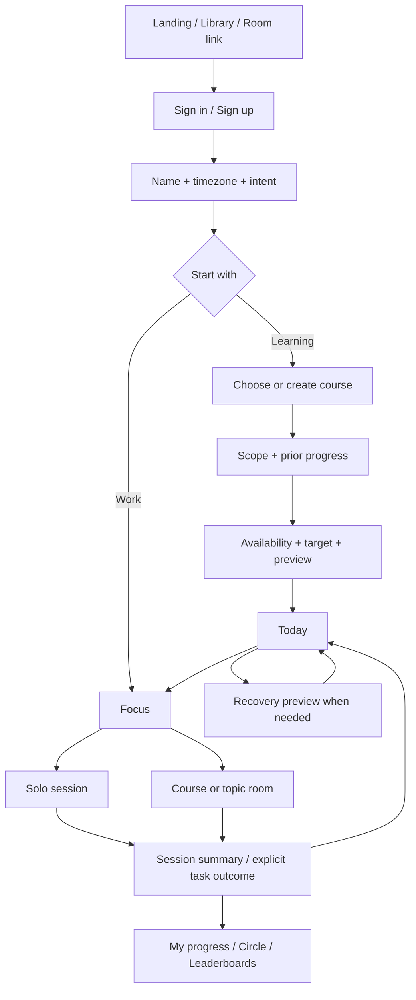

# دِيمة — وثيقة متطلبات المنتج

الإصدار: 1.0 — 31 أكتوبر 2026. الحالة: مواصفات مقترحة جاهزة للتنفيذ المرحلي؛ لم تُبنَ المنصة ولم يُختبر أثرها مع مستخدمين بعد. صاحب القرار: مؤسس ديمة. الأرقام الافتراضية قرارات للنسخة التجريبية، وليست حقائق علمية.

## 1. المنتج والمشكلة

ديمة مساحة لتنظيم التعلّم والعمل المركز: تختار كورسًا أو تضيف كورسك، تبني خطة واقعية، تعرف النشاط التالي، تذاكر وحدك أو مع مجموعة، وتتابع ما أنجزته. عند التعثر تساعدك على إعادة توزيع المتبقي مع الاحتفاظ بإنجازك. الشغل في الإصدار الأول له جلسات وساعات فقط.

المشكلة الأساسية ليست غياب مؤقّت آخر؛ إنها انفصال المنهج عن الجدول والتنفيذ والاستدراك. المستخدم يعرف أنه يريد إنهاء كورس، لكنه لا يعرف حجم العمل اليومي، أو ماذا يفعل بعد فوات يومين، أو أين يجد أشخاصًا يذاكرون نفس المحتوى دون أن ينشغل عن المذاكرة.

**الوعد:** تعرف خطوتك التالية، وتجد رفقة عند الحاجة، وترى تقدمًا صادقًا يمكن استئنافه. لا نعد بإتقان المحتوى أو زيادة الإنتاجية بنسبة غير مقاسة.

## 2. الجمهور وأعماله الأساسية

| المستخدم | ما يريد إنجازه | نجاح التجربة بالنسبة له |
|---|---|---|
| متعلّم ذاتي بكورس أو اثنين | إنهاء منهج في موعد مع وقت محدود | خطة قابلة للفهم ونشاط تالٍ واضح |
| شخص تعثّر أو انقطع | العودة دون إعادة البداية أو تكديس الحمل | خطوة صغيرة ومعاينة استدراك قابلة للتطبيق |
| متعلّم يفضّل الرفقة | جلسة هادئة مع أشخاص في نفس الموضوع | دخول سريع ووقت مشترك مفهوم وخصوصية واضحة |
| مستخدم Work-only | تسجيل عمله المركز | يبدأ بلا إنشاء مشروع أو كورس |
| مساهم بمحتوى | استخدام منهج خاص ثم طلب نشره | استعمال فوري خاص، ومراجعة منفصلة للنشر |
| مراجع/مشرف | اعتماد المناهج ومعالجة الإساءة | صلاحيات محددة وسجل قرارات، دون فتح بيانات الجميع الخاصة |

التسجيل مفتوح، والبداية التشغيلية لمجموعة صغيرة. البداية التعليمية من Google Project Management و CS50 Business؛ ترتيب ومحتوى النسختين يتحقق منهما من المصدر قبل النشر. لا يُفترض أن المستخدم الجديد عند موضع تقدم صاحب المشروع نفسه.

## 3. مبادئ الاختيار

1. النشاط قبل الأرقام: Today يجيب «أعمل إيه الآن؟» قبل عرض الإحصاءات.
2. الكورس والخطة والوقت والإكمال أربعة أشياء مختلفة؛ المؤقّت لا يُكمل الدرس.
3. التعثر يغيّر توزيع المستقبل، ولا يمحو إنجاز الماضي.
4. المشاركة اختيارية؛ الاستخدام الخاص كامل القيمة.
5. المنافسة بين مقاييس معلنة ومتجانسة؛ الساعات ليست جودة تعلّم.
6. الواجهة معبّرة في الاكتشاف، وهادئة أثناء التركيز؛ لا زخرفة تعوق المعلومة.
7. مصدر الحقيقة هو الخادم؛ أوامر المستخدم لا تعدّل النقاط أو الصلاحيات مباشرة.

## 4. نطاق النسخة التجريبية الكاملة

كل P0 أدناه مطلوب قبل وصف الإصدار بأنه يحقق هذا الطلب. ترتيب التنفيذ لا يعني تأجيل الرومز أو الاستدراك خارج الإصدار.

| ID | الأولوية | المتطلب/قصة الاستخدام | النتيجة القابلة للتحقق |
|---|---|---|---|
| D01 | P0 | كزائر أفهم المنتج وأستكشف المكتبة ثم أسجل | landing الحالية أساس بصري؛ عودة إلى الوجهة بعد الدخول |
| D02 | P0 | كعضو أحفظ بياناتي وأعود من جهاز آخر | حساب موثّق؛ فصل بيانات الحسابات؛ حفظ خادمي وحالات مزامنة صريحة |
| D03 | P0 | أختار منهجًا أو أبني منهجي الخاص | مكتبة مراجعة + محرر Course/Module/Task + مسودة قابلة للاستئناف |
| D04 | P0 | أضع موعدًا وتوفّرًا مشتركًا بين كورساتي | معاينة حمل وتوقعات ثم قبول؛ لا مضاعفة للسعة عند إضافة كورس |
| D05 | P0 | أعرف ماذا أفعل اليوم وأحفظ الإنجاز الجزئي | نشاط تالٍ، Open resource، Start focus، Worked on، Complete، Undo |
| D06 | P0 | أستدرك يومًا أو يومين أو انقطاعًا أطول | مراجعة تُبقي التاريخ والراحة والسقف، وتكشف العجز والعمل غير الموزّع |
| D07 | P0 | أركز بمفردي في تعلم أو شغل | Pomodoro + مؤقّت مفتوح؛ استراحة منفصلة؛ جلسة واحدة للحساب |
| D08 | P0 | أنضم/أنشئ رومًا عامًا لموضوع أو كورس | اكتشاف، lobby، جولة مشتركة، دخول متأخر، عودة بعد انقطاع، moderation |
| D09 | P0 | أفهم تقدمي الفعلي عبر الوقت | أربعة مؤشرات منفصلة: المنهج، الوقت، الإيقاع، توقع الخطة |
| D10 | P0 | أتابع زملاء مختارين وتقدمهم بإذنهم | طلب متابعة مقبول + ملخص محدود + اختيار جمهور وحق سحب المشاركة |
| D11 | P0 | أنافس على ساعات العمل والتعلّم وتقدم الكورس | لوحة عامة للساعات وفلاتر Work/Learning؛ لوحة كورس بنطاق/نسخة متجانسين |
| D12 | P0 | أنشر منهجي للآخرين بعد مراجعته | snapshot ثابت؛ pending/changes requested/approved/rejected؛ لا نشر ذاتي فوري |
| D13 | P0 | أعرف ما حُفظ وما تعذّر وأتحكم في بياناتي | offline محدود وصادق؛ export/delete؛ notifications؛ حظر وإبلاغ |
| D14 | P0 | أستخدم الهاتف والكيبورد وأفهم الخطأ | responsive، reduced motion، contrast، حالات فارغة/خطأ/تحميل متماسكة |
| D15 | P0 | يدير الفريق نسخة مستقرة قابلة للاستعادة | صلاحيات واختبارات تكامل ورصد وأمان ونسخ واستعادة وحدود سعة مثبتة |
| D16 | P1 | أخصص تجربة المذاكرة أكثر | أصوات محيطية مرخصة، تخصيص جولات إضافي، حفظ عدة قوالب تركيز |
| D17 | P1 | أخطط لمواعيد مشتركة مستقبلًا | حجز جلسات/غرف خاصة بالدعوة؛ تأتي بعد قياس استخدام الغرف العامة |

### خارج هذا الإصدار

- فيديو أو ميكروفون أو شات حر/رسائل خاصة؛ الغرف صامتة بحضور وهدف خاص وتفاعلات محدودة.
- إدارة مشاريع العمل، قوائم مهام عمل مشتركة، إدارة موظفين أو إثبات ساعات عمل.
- استضافة فيديوهات الكورسات أو نسخ محتواها أو مزامنة رسمية مع Coursera/edX.
- مدرّس AI، توصية منهج بالذكاء الاصطناعي، دفع/اشتراكات، وتطبيق native مكتوب من الصفر. إصدار Android الكامل عبر Capacitor لاحق بعد beta الويب؛ تهيئة البنية وتجربتا M0/M1 مبكرتان ضمن [خطة البناء](IMPLEMENTATION_PLAN_AR.md)، ولا تعنيان إطلاق تطبيق كامل ضمن P0 للويب.
- شراء streak أو نقاط، مكافآت مالية، ترتيب «الأكثر ذكاءً»، feed لا نهائي.

## 5. الرحلة الأساسية

رابط روم لا يُجبر المستخدم على بناء خطة أولًا: يسجل الاسم والمنطقة الزمنية وتأكيد الحساب، يرى جمهور حضوره، ثم يدخل. إضافة الكورس أو الخطة خيار لاحق. العمل والتعلم اختيارات جلسة، وليسا نوعَي حساب دائمين.

### مثال يوم عادي

Today يعرض «Continue Module 3» ومعه نشاطان لاحقان، وحمل اليوم المقدر. يفتح المستخدم المصدر الخارجي ويبدأ جولة فردية أو غرفة نفس الكورس. عند انتهاء الجولة يرى وقته ويختار إن كان النشاط اكتمل أو يحتاج المزيد. لا يُجبر على تقييم مطول.

### مثال العودة بعد يومين

يظهر «Your progress is saved. Let’s adjust what’s next.» مع مقدار العمل الذي يحتاج إعادة توزيع. يمكنه بدء نشاط صغير الآن، أو فتح معاينة تحافظ على الحمل الحالي. إذا لم يكفِ الوقت حتى الموعد، يرى تاريخ الهدف والتوقع الجديد منفصلين؛ زيادة الحمل أو استهلاك الاحتياطي تحتاج اختيارًا صريحًا.

### مثال التعلم الجماعي

من صفحة الكورس يرى الغرف المرتبطة بنفس offering. بطاقة الغرفة تقول «25/5 · Focus · 8 min left · 6 present». قبل الانضمام للجولة يختار العمل في الثماني دقائق أو انتظار التالية. حضوره لا ينشر نسبة تقدمه أو خطته، وخروج المضيف لا يقطع الجولة.

## 6. معمارية المعلومات

Desktop: **Today / My Plan / My Courses / Focus / Progress / Library**. الحساب والإعدادات والإشعارات في شريط الخدمات؛ Contributions من المكتبة/الحساب. البحث السريع اختصار اختياري لا يعوض التصفح العادي.

Mobile: **Today / Plan / Focus / Courses / More**. More يجمع Progress و Library و Contributions و Settings، مع روابط سياقية مباشرة للغرف ولوحات الترتيب من الكورس.

Progress: **Overview / Activity / Circle / Leaderboards**. Focus: **Solo / Rooms**. الكورس: **Outline / Progress / People / Leaderboard**؛ People يجمع الغرف والزملاء المشاركين اختياريًا. لا نخفي وجهة الروم داخل ترتيب تنافسي.

تفاصيل كل صفحة وعقدها في [SCREEN_SPEC_AR.md](SCREEN_SPEC_AR.md).

## 7. قرارات المنتج الحاسمة

| القرار | ما اعتمدناه لهذه المواصفات | السبب |
|---|---|---|
| مصدر الذكاء | قواعد تخطيط حتمية قابلة للتفسير | لا يحتاج AI أو اشتراكًا إضافيًا؛ يسهل اختبار عدم فقد العمل |
| الاستدراك | معاينة ثم Apply | يحترم الموعد والسعة والراحة ولا يحرك الجدول خفية |
| التحفيز | إيقاع أسبوعي + milestones فعلية + مقارنة اختيارية | العودة ممكنة دون إنقاذ سلسلة وهمية |
| التوقيت الجماعي | ساعة غرفة مستقلة عن سجل كل شخص | يمنع الوقت المزدوج واحتساب الاستراحة أو الدخول قبل الوصول |
| متابعة الآخرين | دائرة محدودة وطلبات قبول ومشاركة حقول مختارة | يحقق الرفقة دون فتح الخطط أو إنشاء شبكة اجتماعية كاملة |
| دخول الغرف | عضو موثّق؛ لا فيديو/شات؛ روم موضوع أو offering عام | بداية قليلة الاحتكاك وقابلة للإدارة |
| الساعات اليدوية | محفوظة شخصيًا، خارج المنافسة | مفيدة للسجل، دون مساواتها بالحدود الزمنية المقبولة من الخادم |
| المقارنة بين الكورسات | ممنوعة لترتيب نسب الإنجاز | 50% من كورس قصير لا تعادل 50% من برنامج آخر |
| التحديثات للمناهج | نسخة ثابتة ثم ترقية اختيارية بمعاينة | لا يتغير مقام النسبة أو تاريخ المستخدم دون تفسير |

## 8. النجاح والحدود

المؤشر الرئيسي المقترح: **عدد المستخدمين الأسبوعيين الذين يعودون لفعل تعلم/عمل ذي معنى في يومين مختلفين على الأقل**. تعريف الفعل والنافذة في [DELIVERY_AND_ACCEPTANCE_AR.md](DELIVERY_AND_ACCEPTANCE_AR.md). هذا هدف منتج للاختبار، لا إثبات جودة تعلم.

نراقب تفعيل الحساب، بدء التنفيذ بعد قبول الخطة، العودة بعد التعثر، استمرار الجولات دون أعطال، وضبط الخصوصية. لا نضع نسب احتفاظ أو تحسن مختلقة قبل دفعة الاستخدام الأولى. مؤشرات الحماية: الخطط فوق السعة، تعارض الوقت، الانسحاب من الترتيب، الإبلاغ، وفشل الحفظ.

المخاطر الرئيسية: تقديرات محتوى غير دقيقة؛ تضخم غرف فارغة؛ التنافس على زمن لا يعكس تعلمًا؛ استهلاك realtime؛ استضافة مجانية بحدود؛ إساءة أسماء/غرف؛ وصعوبة الاستدراك عند مشاريع كبيرة. الحلول التنفيذية ومعايير إيقاف الإطلاق محددة في وثائق النظام والتسليم.

## 9. ما يجب حسمه تشغيلًا قبل النشر العام

لا يمنع أي بند بدء التنفيذ المحلي: تفعيل Cloudflare Workers وSupabase وربط dima.study المحجوز لدى Spaceship وفق إفادة المستخدم، بيانات الجهة المشغّلة ونصوص الخصوصية/الشروط الملائمة لجمهورها، مسؤول مراجعة المحتوى والإبلاغ، حقوق أصول الواجهة، وتدقيق الكورسين الافتتاحيين. الجمهور المتوقع50–100 مستخدم، وتفاصيل الاستضافة في [القرار المعتمد](HOSTING_DECISION_AR.md). لا تُنشر عبارة «محتوى رسمي معتمد» أو «وقت موثّق» دون سند.

المواصفات الجديدة تتقدم على الملفات القديمة عند التعارض؛ أهم تغيير هو إدخال الغرف الجماعية والمتابعة المحدودة في P0، وتعديل التنقل. تقارير البحث مقارنات وتوصيات وليست عقد التنفيذ.
